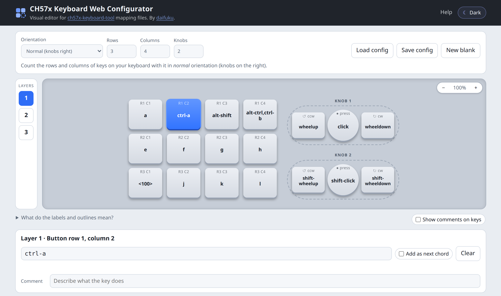

# CH57x Keyboard Web Configurator

A single-file web app for editing [ch57x-keyboard-tool](https://github.com/kriomant/ch57x-keyboard-tool)
YAML mappings and uploading them straight to the keyboard over WebHID (Chrome/Edge desktop). In other
browsers, save the file and upload it with the original CLI (see Help in the page).

**Download and use [`ch57x-keyboard-web-configurator.html`](ch57x-keyboard-web-configurator.html)**: one file, no dependencies, no
network. Open it in a browser. It is *built* from `src/`; don't edit it by hand.



## Layout

```
src/index.template.html   markup; lines like <!-- @inline core.js --> are replaced by src/core.js
src/style.css             styles
src/theme-init.js         migrates renamed localStorage keys, applies the saved theme before first paint (in <head>)
src/core.js               pure logic, no DOM: validation, YAML, state, protocol, upload planner
src/ui.js                 DOM, palette, WebHID
src/theme-ui.js           theme toggle
build.mjs                 inlines src/ into ch57x-keyboard-web-configurator.html (zero dependencies)
test/                     suites (*.cjs) + run.mjs; they load the *built* HTML
test/lib/                 shared test helpers (autoconfirm.cjs answers the in-page confirmation dialog)
test/fixtures/            user YAML (old same-line and `#@` comment forms), upstream example-mapping.yaml, Rust oracle outputs + their action lists, pre-comments HTML
test/reference/           ch57x-programmer TS reference bundled to ref.cjs (committed)
scripts/fetch-refs.sh     clones the reference repos into refs/ at pinned revisions + applies patches/
scripts/regen-oracles.sh  reruns the Rust harnesses to regenerate test/fixtures/*-oracle.txt (needs cargo)
scripts/shots/            Playwright screenshot scripts (visual QA; output in scripts/shots/out/; shot_readme.cjs writes docs/screenshot.png)
docs/screenshot.png       README screenshot
patches/                  oracle harness patches for upstream and the fork
HANDOFF.md                architecture, protocol decisions, history, open items
LICENSE                   MIT licence for this project
THIRD-PARTY-NOTICES.md    MIT notices for ch57x-keyboard-tool (+ fork) and ch57x-programmer, and which files use them
```

## Develop

```sh
npm ci
# edit src/...
npm run build      # writes ch57x-keyboard-web-configurator.html; commit it together with src/
npm run check      # fails if the committed HTML is out of date (CI runs this)
npm test           # all suites; pass another HTML path to test that: npm test -- path/to.html
```

Each suite can also be run alone: `node test/oracle_cmp.cjs [html]`.

Keep `<script id="core">` in the template and keep `src/core.js` free of DOM globals
(`test/core_purity.cjs` enforces it): the suites extract that block and run it in plain Node.

### Reference implementations and oracles

```sh
npm run fetch-refs   # refs/ch57x-keyboard-tool, refs/ch57x-keyboard-tool-enhanced, refs/ch57x-programmer
npm run build:ref    # rebuild test/reference/ref.cjs from refs/ch57x-programmer
sh scripts/regen-oracles.sh   # needs a Rust toolchain
```

### Screenshots

```sh
npm i --no-save playwright && npx playwright install chromium
node scripts/shots/shot_notes.cjs
node scripts/shots/shot_config.cjs   # settings card with Load/Save config, desktop + phone
```

## License

MIT (see `LICENSE`). Builds on [kriomant/ch57x-keyboard-tool](https://github.com/kriomant/ch57x-keyboard-tool) and [PollRobots/ch57x-programmer](https://github.com/PollRobots/ch57x-programmer), both MIT; see `THIRD-PARTY-NOTICES.md`.
